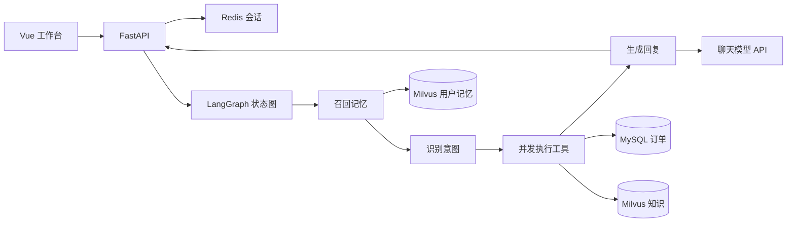

# 拾光 电商智能客服 Agent

基于 **FastAPI + LangGraph + Vue 3** 的电商客服学习项目，支持多意图识别、订单查询、文档问答、跨会话偏好记忆，以及 JSON / SSE 两种回复方式。采用明确的状态图组织后端，适合从 Python 进阶到 Agent 工程实践。

> 本仓库是可公开发布的独立版本，只包含源码和虚构演示数据。不包含私人知识库、API 密钥、模型权重、数据库备份或真实订单。本项目没有接入真实人工客服、支付、退款、改地址或订单取消系统。

## 功能

- 规则优先并由模型补全的多意图识别；订单、FAQ 与商品知识可并发查询。
- MySQL 参数化订单查询，查询条件包含 `user_id`。
- BGE-M3 本地向量化，Milvus 稠密检索与关键词加分重排。
- Redis 保存会话及知识查询缓存；服务不可用时提供进程内兜底。
- Milvus 按用户隔离长期记忆，支持偏好抽取、主题更新和删除。
- Vue 3、TypeScript、Vite、Element Plus、Pinia、Axios，提供流式对话、知识上传、连接设置与响应式布局。

## 从零启动

需要 Git、Python 3.12 或 3.13、Node.js 22.12+ 和 Docker Compose V2。当前本机已验证 Python 3.13；CI 配置另覆盖 Python 3.12，远端执行结果以 Actions 为准。BGE-M3 模型需要数 GB 磁盘空间，CPU 可以运行，首次加载和推理较慢。Docker 建议预留至少 8 GB 内存，实际需求随模型与平台变化。

### 1 克隆与安装

```bash
git clone https://github.com/GengHanLv/ShiGuang-Ecommerce-Agent.git
cd ShiGuang-Ecommerce-Agent
python -m venv .venv
```

Windows PowerShell：

```powershell
.venv\Scripts\Activate.ps1
python -m pip install --upgrade pip
pip install -r requirements.txt -r requirements-dev.txt
```

macOS / Linux：

```bash
source .venv/bin/activate
python -m pip install --upgrade pip
pip install -r requirements.txt -r requirements-dev.txt
```

`requirements.lock.txt` 是当前 Windows / Python 3.13 的已安装版本快照，可用于同类环境复现；跨平台默认先使用 `requirements.txt`。PyTorch GPU 安装方式以 [PyTorch 官方说明](https://pytorch.org/get-started/locally/) 为准，CPU 环境无需 CUDA。

### 2 生成配置

```bash
python -m scripts.setup_env
```

打开新生成且不会提交的 `.env`，填写 `OPENAI_API_KEY`、`OPENAI_BASE_URL`、`CHAT_MODEL`。这组字段用于兼容聊天 API 的模型服务。`API_KEY` 是本应用独立的访问凭证，脚本会自动生成；前端连接时用它，不能用模型服务商密钥代替。

数据库密码、MinIO 密码也由脚本随机生成。已有 `.env` 不会被覆盖；不要把真实密钥写入 README、前端 `VITE_*` 或源码。

### 3 启动基础服务

```bash
docker compose up -d
docker compose ps
```

等待 MySQL、Redis、etcd、MinIO、Milvus 的健康检查通过。所有宿主机端口仅绑定 `127.0.0.1`：MySQL `3307`、Redis `6380`、Milvus `19530`；MinIO / etcd 不对宿主机暴露端口。Milvus 使用 [官方 v2.5.27 部署拓扑](https://milvus.io/docs/v2.5.x/install_standalone-docker-compose.md)，没有开启 `seccomp:unconfined`；若宿主机的 Docker 安全策略导致启动失败，应先查看日志并按官方环境要求排查。

如果本机已运行这些服务，不要重复启动冲突端口；可复用已有实例并修改 `.env`。首次新建的 MySQL 数据卷会执行 `init_db.sql`，生成虚构商品及用户 `user123` 的两条订单；旧数据卷不会重复执行 SQL。

### 4 下载向量模型与导入演示知识

```bash
python -m scripts.download_embedding
python -m scripts.seed_knowledge
```

模型来自 [BAAI/bge-m3](https://huggingface.co/BAAI/bge-m3)。也可自行下载完整目录，并设置 `BGE_M3_MODEL_PATH`。维度必须为 `1024`，更换模型或维度时需要新建匹配集合。演示知识共 12 条，为本项目编写的虚构资料；再次执行会跳过相同正文，不会清空集合。

### 5 启动后端与前端

终端一，在项目根目录并激活虚拟环境后：

```bash
python -m uvicorn backend.app.main:app --host 127.0.0.1 --port 8000 --reload
```

终端二：

```bash
cd frontend
npm ci
npm run dev
```

打开 http://127.0.0.1:5173 ，进入“连接设置”，保持服务地址 `/api`，填写 `.env` 中的 **API_KEY** 和用户标识 `user123`，保存并检测。Vite 会把 `/api` 转发到本机 8000 端口。

按顺序试用：

1. “订单号1到哪了？”——预期查询虚构订单的已发货状态。
2. “演示蓝牙耳机的续航和降噪功能是什么？”——预期召回公开样例资料。
3. “以后快递到了请电话通知我。”——保存偏好；新建会话后再问偏好。
4. 上传自有 PDF / TXT / DOCX 到知识中心，再询问其中内容。

模型首次加载可能耗时数分钟，前端对话超时为 5 分钟。后端 `/docs` 提供 Swagger。

## 架构



当前是**固定图驱动的单 Agent 工作流**，没有 ReAct 循环、多 Agent 协商或 LangGraph checkpointer；会话持久化由 Redis 单独实现。`hybrid_search` 实际是稠密候选加关键词加分，没有 BM25、RRF 或 Cross-Encoder。人工转接只返回占位话术。

```text
backend/app/
  api/                HTTP、鉴权、请求模型、SSE
  agent/              状态、图、节点、提示词
  tools/              订单业务工具
  memory/             会话与长期记忆
  rag/                文件分块、检索、缓存
  infrastructure/     MySQL、Redis、Milvus、Embedding
  core/               配置、模型客户端、日志
frontend/src/         Vue 页面、组件、状态与接口层
examples/             可公开的虚构商品与 FAQ
scripts/              配置生成、模型下载、演示入库
tests/                行为回归测试
evals/                规则回归与可选的模型评测
docs/                 入门教程、面试准备、上传手册
```

## API

除 `/health` 外，接口均使用 `X-API-Key`。用户标识由调用方提供，仅用于本地演示隔离；共享 API Key 不是完整的多用户认证。

| 接口 | 作用 |
| --- | --- |
| GET /health | 进程探活，不加载模型 |
| GET /status | 检查 Redis、MySQL、Milvus |
| GET /knowledge | 返回知识集合实际片段数 |
| POST /chat | JSON 对话，异常时返回 degraded 标记 |
| POST /chat/stream | POST SSE，事件为 token、done、error |
| POST /upload | PDF / TXT / DOCX，最多 10 MB；collection 为 faq 或 product_knowledge |

调用示例（使用本地 `.env` 中生成的应用凭证）：

```python
import os
import requests
from dotenv import load_dotenv
load_dotenv()
response = requests.post("http://127.0.0.1:8000/chat", headers={"X-API-Key": os.environ["API_KEY"]},
    json={"user_id": "user123", "message": "订单号1到哪了？", "session_id": "demo-1"}, timeout=300)
print(response.json())
```

API Key 只在前端 `sessionStorage` 保存。浏览器对话保存在 `localStorage`，可从设置清除；清除浏览器历史不等于删除 Milvus 长期记忆。Redis 保留最近 20 条消息、TTL 1 小时；服务端过期后不会从浏览器自动恢复上下文。

## 测试与构建

```bash
python -m unittest discover -s tests -v
python -m evals.memory_regression
cd frontend
npm test
npm run build
```

上述测试不调用付费模型，验证接口契约、SSE、会话隔离、上传清理、缓存更新和记忆规则。`python -m evals.evaluate` 是可选模型在线评测，会调用配置的模型服务；不是默认 CI 步骤。CI 使用 GitHub Actions。

## 常见问题

- 401：前端需要应用 `API_KEY`，不是 `OPENAI_API_KEY`；保存配置后重试。
- 数据库拒绝访问：核对密码和端口。修改 `.env` 不会自动改掉已有 MySQL 数据卷里的账号密码。
- Milvus 连接失败：等待健康检查，查看 `docker compose logs --tail=100 milvus etcd minio`；已有服务时不要混用多个实例。
- 模型找不到：核对完整模型目录、磁盘空间和下载是否完成；不要把模型权重提交 Git。
- 空白 PDF：扫描件没有可提取文本，请先 OCR；DOCX 当前只提取正文段落，复杂表格不保证覆盖。
- 检索不准：先查入库正文、分块边界、向量维度和 Top-K，再做小型人工标注评测；不要直接提高阈值后宣称质量提升。
- GPU / OpenMP：CPU 可以运行；GPU 问题先核对 PyTorch 和驱动。当前代码设置了兼容用的 `KMP_DUPLICATE_LIB_OK`，生产环境应修复库冲突。

## 部署与边界

当前默认仅本机使用；正式上线需要真实用户认证、服务鉴权、限流、审计、秘密管理、持久任务与统一观测。会话锁只在单进程内有效，多 worker 时需分布式协调。长期记忆的同主题删除再写入不具备跨服务事务保障。

前端生产文件位于 `frontend/dist`，部署需 SPA 回退与 `/api` 反向代理，SSE 需关闭代理缓冲。保留当前开发默认单 worker，有助于避免同会话竞态。

`docker compose down` 停止本项目容器，保留命名数据卷。不要随意使用 `down -v`，它会删除演示数据库和向量库数据。

## 许可

源码采用 [MIT License](LICENSE)。第三方依赖、模型和自行导入的资料按各自许可使用。
