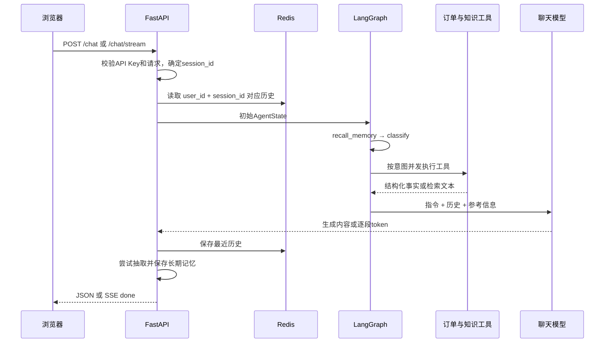

# 从 Python 入门理解电商 Agent 的架构

这份教程面向会写 Python、略接触 FastAPI 和 LangChain 的同学。目标是读懂项目里一次请求经过哪些函数、为什么使用 Redis 与 Milvus，以及每个设计的实际边界。阅读时请打开同目录对应源码；公开版本使用虚构样例，本地私人知识库不在发布范围内。

## 1 先理解项目解决什么问题

一个只会调用聊天 API 的程序，把问题发给模型、拿回一句话就结束了。模型并不知道你的真实订单，也不会因为你说过“晚上收货”就自动永久记住。这个项目在模型前后添加了可执行的业务工具、检索、记忆和 HTTP 接口。

用户说“查订单1，再说说怎么退货”，系统需要先识别两个需求，分别访问 MySQL 和知识库，把结果交给模型组织语言。模型负责理解和表达，业务事实来自工具；工具没查到的信息应明确无法确认。项目当前不修改订单、不执行退款，因此也不应回答“已退款成功”。

可以把 Agent 理解为“模型 + 可调用的工具 + 状态 + 执行流程”。这不是唯一的学术定义，但足以理解本项目。当前流程大部分由程序固定控制，属于工作流驱动的单 Agent；没有让模型无限循环自主规划下一步。

## 2 技术栈与各自职责

| 技术 | 用 Python 基础理解 | 在项目里做什么 | 不负责什么 |
| --- | --- | --- | --- |
| FastAPI | 把 Python 函数包装成 HTTP 接口 | 校验请求、鉴权、返回 JSON 或流 | 不负责 Agent 的业务决策 |
| Pydantic | 带校验的输入输出对象 | 限制消息、用户和会话字段长度 | 不自动证明调用者身份 |
| LangChain / langchain-openai | 对模型调用和消息格式的封装 | SystemMessage、HumanMessage、ChatOpenAI | 不自动解决幻觉 |
| LangGraph | 将函数串成带状态的流程图 | 节点运行、状态合并、事件流 | 当前未启用断点恢复或持久化 checkpoint |
| Redis | 带过期时间、可跨请求共享的键值服务 | 最近对话、知识查询缓存、缓存版本 | 不是永久事实库 |
| MySQL + SQLAlchemy + aiomysql | 存结构化表格并用 SQL 查询 | 订单按用户、订单号筛选 | 不是语义相似度搜索 |
| BGE-M3 | 把句子转成一串数字的本地模型 | 生成1024维稠密向量 | 不是生成最终回答的模型 |
| Milvus | 存向量及附加字段，搜索相似内容 | 商品/FAQ召回、用户长期记忆 | 不替代订单事务数据库 |
| Vue 3 + Vite | 浏览器界面与开发构建工具 | 三个页面、响应式工作台 | 不保管模型服务商密钥 |
| Element Plus + Pinia + Axios | UI组件、页面共享状态、HTTP客户端 | 表单、连接配置、请求 | SSE流还需要独立解析逻辑 |
| Docker Compose | 按配置启动一组独立服务 | MySQL、Redis、Milvus等依赖 | 不会把 Python 代码自动变成 Agent |

这些概念的基础定义可参阅 [FastAPI并发文档](https://fastapi.tiangolo.com/async/)、[Redis数据存储入门](https://redis.io/docs/latest/develop/get-started/data-store/) 和 [LangGraph Graph API](https://docs.langchain.com/oss/python/langgraph/graph-api)。具体参数以下面的项目实现为准。

## 3 从浏览器到回答的完整路径



`api/routes/chat.py` 的 `prepare_state()` 先取历史，将当前用户输入追加为最后一条消息。`build_graph().ainvoke()` 执行整张图；返回后 `persist()` 保存历史并尝试抽取记忆。流式模式用 `astream_events(version="v2")`，只转发带 `response` 标签的最终回复模型片段，避免把意图分类内容展示给用户。

注意最后一步：当前记忆写入被 `await`，不是后台队列任务。用户可能已经看见 token，但 `done` 仍要等持久化流程完成。可以优化成持久任务队列，但需要补偿、重试和状态设计，不能简单宣称已经异步后台处理。

## 4 用四个 Python 函数理解 LangGraph

真实图在 `agent/graph.py`，顺序是：

```text
recall_memory → classify → tools → generate → END
```

- `recall_memory`：根据消息决定是否召回相关用户偏好，不需要记忆的场景可跳过。
- `classify`：先运行关键词与规则，规则不够确定时才调用模型，再白名单校验意图。
- `tools`：根据意图选择订单查询、FAQ检索、商品检索或转人工占位结果。
- `generate`：将历史和参考信息组成提示词，生成最终答案；纯转人工直接返回固定话术。

`AgentState` 可以先理解为“所有节点共用的一张字典”。`messages`、`intents`、`tool_results`、`memory_hits` 等是里面的键。节点返回的是更新字段，不必把整个字典原封不动返回。

```python
# 节点只返回自己负责的字段
async def classify_example(state):
    return {"intents": ["order_query"], "order_id": 1}
```

`state.py` 中的 `messages: Annotated[list[dict], operator.add]` 指定“列表相加”作为合并方式。因此生成节点只返回新回答，就会追加到历史。其余没有 reducer 的字段默认被新值覆盖。例如 `intents` 应表示本轮意图，不该把上一轮意图不断累加。[官方Graph API对State、Node和Reducer的说明](https://docs.langchain.com/oss/python/langgraph/graph-api)解释了这个机制。

`@lru_cache(maxsize=1)` 缓存编译后的图对象，不是把所有用户的数据放在同一个会话。每次调用仍然传入独立状态。相反，若在模块全局放一个共享的 `history=[]` 再不断追加，就容易串用户。

项目没有条件边：有条件的是节点内部的规则及工具选择。没有 ReAct 的“思考→工具→观察→再思考”循环，也没有执行次数预算。若面试问为什么不用普通函数串起来：当前规模确实可以；LangGraph主要为清楚的状态约定、节点分离和事件观测提供组织方式，不能把框架本身当成效果提升证据。

## 5 Redis 到底是什么

你可能写过 `cache = {}`。它存在当前 Python 进程，重启就丢，多个 worker 不共享。Redis 是独立运行的服务，不同请求和进程可以通过网络读写同一份键值数据。数据通常放在内存中，因此应控制大小，并按需要配置持久化。

项目有三种主要键：

```text
session:v2:<hash(user_id, session_id)>       对话列表JSON
rag:<collection>:<generation>:...:<hash>    某问题的检索结果
rag:version:<collection>                   知识集合缓存版本
```

会话 TTL 为3600秒，最多保留20条消息，不是20轮对话。每次保存重新设置TTL。`user_id` 与 `session_id` 一起参与哈希，避免两个用户碰巧使用同一个会话ID就共享历史。哈希是构造稳定键名，不是认证，也不是把内容加密。

缓存意味着“结果能复用就不重新算”。知识检索结果缓存1小时：同一集合、版本、Top-K、阈值与问题可命中同一键。新文档入库后 `invalidate_knowledge_cache()` 增加集合版本，后续请求使用新键；旧键依靠TTL逐步过期，不用扫描删除所有旧缓存。

Redis不可用时会退回有界进程内字典：最多1000个会话，并清理过期项。它能提高可用性，但多worker各自有不同兜底内容；Redis恢复后还可能读到旧值，当前没有自动一致性对账。

`SessionManager.lock()` 用 `asyncio.Lock` 防止同一进程内同会话读写交错。这不是 Redis 分布式锁。扩成多进程以后仍会出现“同时读旧历史、各自覆盖”的问题，需要序号/CAS、分布式互斥或按会话排队。

## 6 Milvus 与向量检索

普通数据库比较“订单号是否等于1”。用户问“耳机能用多久”，资料可能写“标称续航20小时”，字符串不一样，但意思有关。Embedding模型把两段文字各变成1024个浮点数，让语义相关内容更容易在向量空间接近。

假设简化为三维：问题是 `[0.8,0.2,0.1]`，文档是 `[0.7,0.3,0.1]`。余弦相似度比较两个向量夹角方向：

```text
cos(q,d) = (q·d) / (||q|| × ||d||)
```

这里只是解释公式，真实代码使用1024维。相似度不是正确率或置信概率，更不能说0.8代表80%答对。向量、距离度量和索引需要匹配。

项目集合为：

| 集合 | 字段 | 用途 |
| --- | --- | --- |
| product_knowledge | id、text、embedding | 公共商品资料 |
| faq | id、text、embedding | 公共常见问题 |
| user_memory | id、user_id、memory_type、text、embedding | 用户偏好与持久反馈 |

`infrastructure/milvus.py` 延迟连接，创建 IVF_FLAT + COSINE 索引，`nlist=128`，查询 `nprobe=16`。可把IVF理解为先分组，查询时只搜索部分组以换取速度；参数适合程度必须用实际数据测量，样例小库不代表生产最优。需要精确召回基准时，应与全量/精确搜索比较。

长期记忆检索把 `user_id == ...` 作为 Milvus 过滤表达式传入，不是取回全库后再在Python中删别人数据。过滤失败时不应偷偷重试无过滤查询。参阅 [Milvus Filtered Search](https://milvus.io/docs/filtered-search.md)。这个过滤只是数据访问约束，身份本身仍需由可信认证提供。

当前 `hybrid_search` 实际先取最多 `top_k*3` 个稠密候选，然后按查询关键词命中数每个加0.3排序。它没有独立稀疏检索通道，不能补回未进入稠密候选的文档。加分后结果可大于1，不再是纯余弦；下游用0.5阈值过滤的是混合排序分数，存在校准问题。这也是一个可解释的改进点，而不是“已实现高精度BM25混合召回”。

## 7 RAG 文档链路

RAG是“先检索参考资料，再让模型基于资料生成”。它不修改大模型参数，所以不等同于微调。商品条款更新时通常重新入库，比为每次规则变更重训模型更直接。

```text
PDF / TXT / DOCX
→ 提取文本
→ 分块（最多500字符，相邻约50字符重叠）
→ BGE-M3向量化
→ 写入Milvus
→ 用户问题向量化
→ 候选召回与重排
→ 填入回复提示词
```

`rag/ingestion.py` 按字符控制长度，在后半段寻找中文句末或换行作为边界，找不到则硬切。它不是严格的语义分块，也不是500个token；字符数与模型token数没有固定换算。重叠用于减少边界信息丢失，同时会带来冗余。

上传限制10MB、允许集合白名单，临时文件在 `finally` 清理。PDF当前不做OCR，DOCX只读取正文段落。批量向量化当前每批64条；低显存机器可能需要减小 `EMBED_BATCH`。若第2批失败，第1批可能已经留在库里，现有通用上传没有整份文档事务或文档ID去重机制。

知识检索的结果是原文文本片段，不是答案。回复节点将资料放入上下文，要求未知信息说明无法确认。提示词能约束行为，但不是完整的提示注入防护；恶意文档依然需要来源审查和数据/指令分离。

## 8 短期记忆和长期记忆

短期记忆用于理解当前对话：“订单1在哪里？”后又问“那能退吗？”需要知道“那”指上一轮。它存最近消息，过期可以释放。

长期记忆保存跨会话仍有用的信息：“以后晚上收货”“到货请电话通知”。订单当前是否发货是动态事实，应该实时查询MySQL，不应抽成长期偏好。记住旧订单状态会让系统以后用过期事实回答。

真实流程是：

1. 规则判断是否值得抽取；普通问候和查询过程直接跳过。
2. 调用模型输出JSON候选（preference / fact）。
3. 解析JSON并用规则清洗，拒绝订单状态、过程描述等噪声。
4. 搜索同用户、同主题旧记忆，删除旧内容后插入新内容。
5. 查询时按用户过滤、相似度筛选、去重及主题冲突清理。

“以后改成早上收货”需要替换晚间偏好，不是把两者并列塞给模型。当前通过主题规则和相似召回处理；删除旧记录与插入新记录不是事务，插入失败会丢旧值。生产可引入主题唯一键、版本、软删除或关系库存主记录，以可恢复更新替代直接删除。

## 9 MySQL 为什么仍有必要

订单号、用户ID、状态都是结构化字段，用SQL精确查询比向量近似匹配更合适。`tools/orders.py` 始终以 `WHERE user_id=:uid` 约束，再可选加入 `AND id=:oid`。绑定参数避免把用户输入当SQL代码拼接。

数据库连接由异步连接池管理：`pool_size=10`、`max_overflow=20`；会话用 `async with` 归还。连接池不表示最多只能服务30个用户，只限制同时借出的数据库连接，其他任务可能等待。多进程会各自创建连接池，总连接数需乘worker数量。

只有查单工具，没有取消或修改SQL。意图说明中出现“改地址”不等于系统真的能改地址；业务能力必须看实际工具实现。

## 10 异步 并发 与 SSE

`async def` 在等待网络或数据库I/O时能让出执行机会。它不会把CPU密集的模型推理自动变快。同步Milvus客户端及本地Embedding被放到 `asyncio.to_thread()` 中，主要是避免阻塞事件循环，不等于无限扩容推理能力。[FastAPI官方并发说明](https://fastapi.tiangolo.com/async/)可用于补基础概念。

`asyncio.gather(..., return_exceptions=True)` 并发执行无依赖工具，一个工具异常时保留其他工具的结果。两项任务各耗1秒，理论等待可接近较慢那项，但真实耗时还取决于线程、连接池、CPU/GPU竞争；项目没有测得固定加速倍数。

SSE是服务器持续发送文本事件。这里用POST携带消息与鉴权头，前端通过流式HTTP读取，不是原生 `EventSource` 自动重连。TCP每次读取的边界不保证对齐一个事件，解析器需要累积缓冲再按空行分帧。`token` 用于逐段展示，`done` 携带完整权威回复，`error` 表示未完成。

停止生成会终止前端请求；不能把它等同于“所有远端模型任务已取消且绝不计费”。代理部署需关闭SSE缓冲，设置适当读超时。

## 11 当前工程的长处与需要补齐的地方

长处是职责清楚：HTTP不写SQL，节点不承担文件解析，数据库细节集中在适配层；规则能单独测试，模型客户端延迟加载，接口导入不需要先下载大模型。

还需补齐：真实身份认证、分布式会话协调、上传幂等、长期记忆原子更新、结构化来源元数据、检索质量基准、模型调用预算、脱敏日志、限流与监控。当前长期记忆日志会记录部分输入和抽取内容，部署前要按隐私要求处理；“密钥没进Git”不等于运行时没有隐私问题。

优先按问题改造：先证明是否串用户，再证明资料检索是否正确，再量化延迟和成本。没有测量前不要在简历写QPS、P95下降比例或“线上提升xx%”。

## 12 两周学习路线

| 天数 | 阅读与动手 | 完成标准 |
| --- | --- | --- |
| 1–2 | 启动公开版、读api/schemas和chat路由 | 画出一次请求完整路径，解释两个API Key |
| 3–4 | 读graph/state和四个节点 | 自己写两个状态节点，观察列表追加与字段覆盖 |
| 5–6 | 读session.py，学习Redis GET/SET/EXPIRE | 解释20条消息和TTL；设计同会话并发反例 |
| 7–8 | 读ingestion/retriever/Milvus适配 | 上传自己的资料，查看chunk，手工标注10个问题 |
| 9–10 | 读memory/signals/policy/long_term | 解释“记住晚上”到“改成早上”的数据变化 |
| 11–12 | 测试接口异常、SSE与用户隔离 | 跑完回归，并用自己的话解释测试保护什么 |
| 13–14 | 补召回评测和面试口述 | 准备2分钟项目介绍及三项已知限制 |

练习时可使用独立的演示数据库和临时用户，不要对私人知识库做清空操作。只运行单元测试与规则回归不需要调用付费模型；真实对话和抽取才会使用模型API。

## 13 阅读顺序与自测

建议依次读 `api/schemas.py → api/routes/chat.py → agent/graph.py → agent/state.py → agent/nodes/ → tools/orders.py → memory/session.py → rag/ → memory/long_term.py → infrastructure/`。

不看代码回答以下问题：为什么需要两个数据库加Redis？历史、缓存、长期记忆分别丢失会怎样？模型为什么不能直接生成SQL操作数据库？为什么错误时不能无过滤重试？500字符是否等于500token？把worker改成4会破坏哪些假设？能解释清楚这些问题，就比只记技术名词更接近真正理解这个项目。
