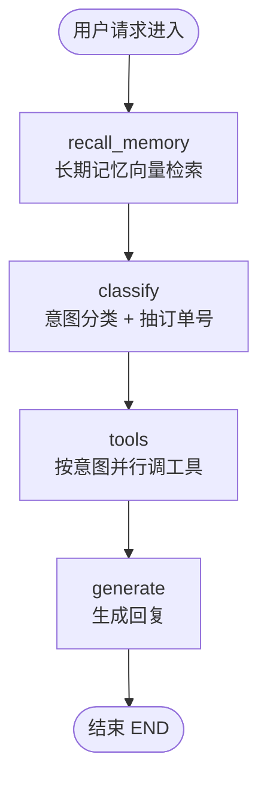
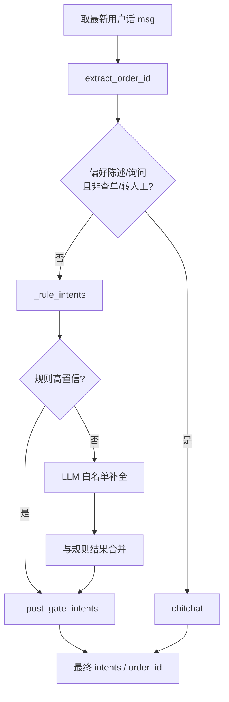
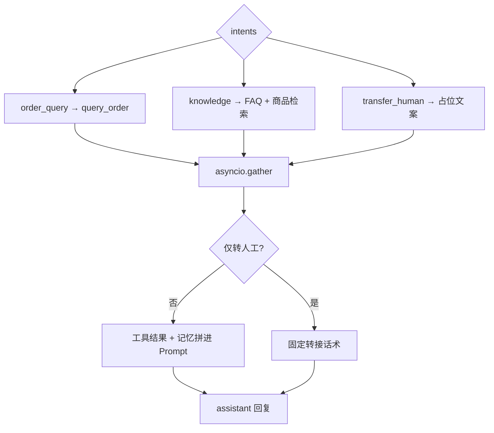

# graph.py 状态流程图

对应文件：`src/graph.py`  
主链路：`recall_memory → classify → tools → generate → END`

## 图 1：主状态图



## 图 2：classify



## 图 3：tools / generate



```text
请求
  └─ recall_memory：按 user_id 检索长期记忆
       └─ classify：规则高置信则直接出门禁；否则 LLM 白名单补全后再门禁
            └─ tools：并行查订单 / FAQ·商品 / 转人工
                 └─ generate：拼 context 生成回复
                      └─ END（main 侧抽取本轮记忆写入）
```

| 字段 | 谁写入 / 使用 |
|------|----------------|
| `messages` | 入口带入；`generate` 追加 assistant |
| `memory_hits` | `recall_memory` 写出 |
| `intents` / `order_id` | `classify` 写出 |
| `tool_results` | `tools` 写出 |
| `user_id` / `session_id` | 入口带入 |
